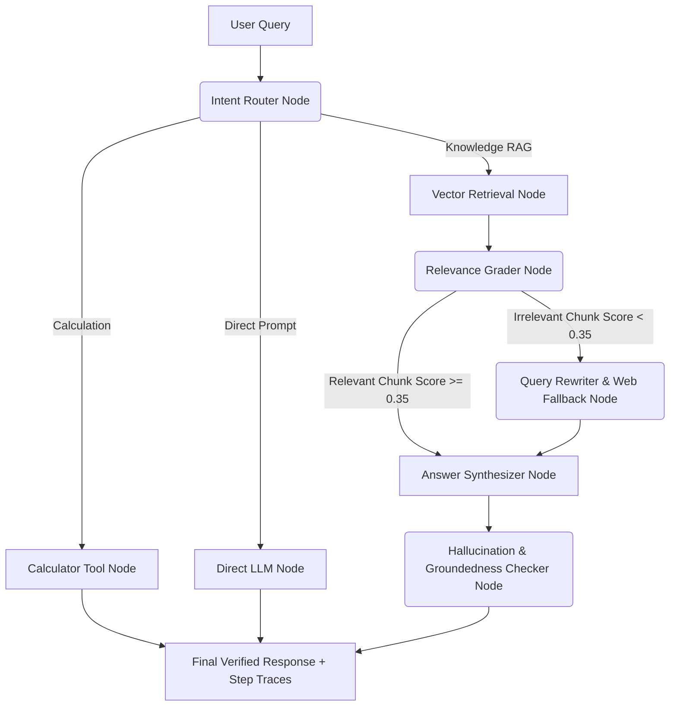

# 🤖 Agentic RAG Engine: Self-Corrective Multi-Agent Knowledge & Retrieval Framework

[](https://www.python.org/)
[](LICENSE)
[](#architecture)
[](http://127.0.0.1:8000/docs)

An enterprise-grade, **Agentic Retrieval-Augmented Generation (RAG)** framework with **Self-Correction**, **Dynamic Intent Routing**, **Query Reformulation**, **Hallucination & Groundedness Verification**, and **Web Search Fallbacks**.

---

## 🌟 Architectural Features

1. **🎯 Dynamic Intent Router Node**: Automatically routes input queries to Vector RAG, Safe Calculation Sandbox, Web Fallback Search, or Direct Synthesizer based on prompt semantic classification.
2. **🔄 Self-Correction & Reflection Loop**: Grades retrieved vector chunks against a relevance threshold (`relevance_threshold = 0.35`). If the retrieval score is below threshold, triggers an automated **Query Rewriter** node followed by an external **Web Fallback Search** node.
3. **🛡️ Hallucination & Groundedness Verification**: Evaluates generated text against ground context snippets before returning output to ensure zero hallucination and high factual fidelity.
4. **⚡ Zero-Dependency Lightweight Vector Store**: Built-in TF-IDF + Cosine Similarity Vector Database built on NumPy. Includes chunking, overlapping, indexing, local JSON persistence, and fast top-$K$ retrieval out-of-the-box.
5. **🔌 Unified LLM Provider Interface**: Supports **OpenAI API** (`gpt-4o`, `gpt-4o-mini`), **Anthropic**, or a zero-dependency **Local Synthesizer** (runs immediately without needing paid API keys).
6. **🚀 Production REST API & CLI**: Full **FastAPI** web server with interactive OpenAPI docs (`/docs`) and an interactive Command Line Interface (`cli.py`).

---

## 📐 Graph Topology & Workflow Architecture



---

## 🚀 Quick Start Guide

### 1. Installation & Environment Setup

Clone the repository and install dependencies:

```bash
git clone https://github.com/YOUR_USERNAME/agentic-rag-engine.git
cd agentic-rag-engine

# Create virtual environment (optional)
python -m venv venv
# On Windows:
venv\Scripts\activate
# On Linux/macOS:
source venv/bin/activate

# Install requirements
pip install -r requirements.txt
```

---

### 2. Running via Command Line Interface (CLI)

#### Seed Sample Knowledge Base:
```bash
python cli.py seed
```

#### Query Knowledge Base (Agentic RAG Flow):
```bash
python cli.py query "What are the core design principles of agentic workflows?"
```

#### Execute Calculation Tool Intent:
```bash
python cli.py query "calculate: 150 * 12 + 450"
```

#### Get Structured JSON Response with Step Traces:
```bash
python cli.py query "Explain decision optimization" --json
```

---

### 3. Running the REST API Server

Launch the server with Uvicorn:

```bash
python cli.py serve --port 8000
```

Access API Documentation:
- **Interactive OpenAPI Docs**: `http://127.0.0.1:8000/docs`
- **Health Endpoint**: `http://127.0.0.1:8000/health`

#### Example API Payload (`POST /query`):
```json
{
  "query": "How does Decision Optimization integrate with Agentic RAG?",
  "top_k": 4,
  "enable_web_fallback": true
}
```

#### Example Response:
```json
{
  "query": "How does Decision Optimization integrate with Agentic RAG?",
  "intent": "knowledge_rag",
  "answer": "Based on the verified knowledge base context...",
  "retrieved_chunks": [
    {
      "chunk": {
        "doc_id": "decision_optimization.md",
        "content": "Decision Optimization combines mathematical programming...",
        "metadata": {"source": "decision_optimization.md"}
      },
      "score": 0.88
    }
  ],
  "relevance_grade": {
    "score": 0.88,
    "is_relevant": true,
    "reasoning": "Top vector similarity score (0.8800) satisfies relevance threshold."
  },
  "hallucination_grade": {
    "is_grounded": true,
    "score": 0.95,
    "hallucination_detected": false,
    "reasoning": "Passed groundedness verification."
  },
  "reflection_attempts": 0,
  "execution_time_sec": 0.0052
}
```

---

## 📁 Repository Directory Structure

```
agentic-rag-engine/
├── .gitignore                  # Git ignore configuration
├── README.md                   # Project documentation & architecture overview
├── requirements.txt            # Package dependencies
├── cli.py                      # CLI entrypoint (seed, query, ingest, serve)
├── data/
│   └── sample_docs/            # Markdown knowledge base files
│       ├── agentic_flows.md
│       └── decision_optimization.md
├── src/
│   └── agentic_rag/
│       ├── __init__.py
│       ├── config.py           # Configuration parameters & threshold settings
│       ├── schema.py           # Pydantic data schemas & state models
│       ├── vectorstore.py      # TF-IDF + Cosine similarity Vector DB engine
│       ├── llm.py              # LLM abstraction (OpenAI / Local Mock Provider)
│       ├── tools.py            # Agent tools (Vector Search, Web Search, Calculator)
│       ├── agent.py            # Node components (Router, Grader, Synthesizer)
│       ├── workflow.py         # State-Graph Agentic Orchestration Engine
│       └── api.py              # FastAPI REST endpoints
└── tests/
    ├── __init__.py
    ├── test_vectorstore.py     # Vector store unit tests
    ├── test_agent.py           # Workflow engine unit tests
    └── test_api.py             # FastAPI integration tests
```

---

## 🔒 Granting Access on GitHub / GitLab

To share this codebase with **`contact@decisionopt.com`** (or **`jay.joshi@decisionopt.com`**):

### On GitHub:
1. Push your repository to GitHub:
   ```bash
   git init
   git add .
   git commit -m "feat: initial release of Agentic RAG Engine"
   git branch -M main
   git remote add origin https://github.com/YOUR_USERNAME/agentic-rag-engine.git
   git push -u origin main
   ```
2. Go to your GitHub repository -> **Settings** -> **Collaborators**.
3. Click **Add people** and enter `contact@decisionopt.com` (or `jay.joshi@decisionopt.com`).
4. Select **Read** or **Write** access and send invitation.

---

## 🧪 Running Unit Tests

Run test suite:
```bash
python -m unittest discover tests
```

---

## 📄 License
This project is licensed under the MIT License - see the [LICENSE](LICENSE) file for details.
